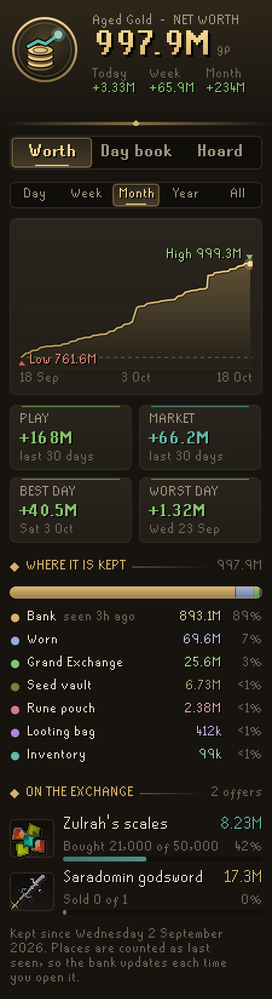
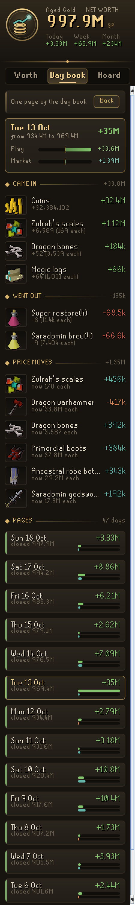

# Codex Ledger

**Your net worth over time, and where your gold went.** Codex Ledger keeps count of everything your account owns (bank, inventory, worn gear, Grand Exchange offers, rune pouch, seed vault and looting bag), draws your worth as a line over days, weeks and months, keeps a day book that splits every change into what you gained or spent and what prices did, books every Grand Exchange trade with its profit after tax, and tells you when you reach your goal at your pace.

It is the sixth plugin in the **Codex** suite, after [Codex Navigator](https://github.com/Nubles/OSRS-Codex-Navigator), [Codex Guardian](https://github.com/Nubles/OSRS-Codex-Guardian), [Codex Log Insight](https://github.com/Nubles/OSRS-Codex-Log-Insight), [Codex Gear Roadmap](https://github.com/Nubles/OSRS-Codex-Gear-Roadmap) and [Codex Session Chronicle](https://github.com/Nubles/OSRS-Codex-Session-Chronicle), and shares their look: warm ink, aged gold and the game's own fonts.

<p align="center">
  
  
  
  
</p>

## What it does

- **Worth.** Your net worth in large gilt figures with what it did today, this week and this month. A line chart for the last day, week, month, year or all time, with the high and low marked and a crosshair that reads out any moment. Tiles for the range's play and market and its best and worst days (or the day's high and low), then where your worth is kept, place by place, with when each was last seen, and each Grand Exchange offer with how far it has got and what is sitting in it.
- **Goal.** Set a worth to aim for (a Twisted bow, say) and the Worth page shows how far along you are and the day you get there at your last 30 days' pace, days off included. With no goal set it aims at the next round figure.
- **Day book** (the Days page). Where the gold came from and went, for today, the last 7 or 30 days, or all time: the change split into **play** (items gained or spent, at that day's prices) and **market** (prices moving on what you held), then **where it went**: the play taken apart into Exchange (trading against the market price, after tax), Loot, Supplies, Coins in, Coins out and Deaths (what dying took, less what you got back from the gravestone or Death). Then the items that brought the most in, the supplies that took the most out, and the biggest price moves on your holdings. Below that, a page for every day with its close and change, as far back as the day book goes. Click a page to open that day on its own.
- **Trades.** Every Grand Exchange trade, for today, the last 7 or 30 days, or all time: profit after the 2% tax, what you bought and sold, the tax paid and your return on cost, then each item with what it made, and what you still hold from your buys with what it would fetch now after tax. Each sale is matched to the average cost of what you bought while the ledger watched; items you sell that it never saw you buy (loot, or bought before) are named, with no profit or loss made up for them.
- **Hoard.** Everything you hold, most valuable first, with each item's share of your worth and (on hover) where it is kept. Items with no Grand Exchange price are named at the bottom, so you know what counts as nothing.
- **Login summary.** A line in the chat box when you log in with your worth, today's change and how much it moved while you were away (prices, finished Grand Exchange offers). It can be turned off.
- **Plaque.** An optional slim plaque in the game view with your worth and today's change.

<p align="center">
  
  
  
</p>

## How it counts

Each place is read when the game shows it to you, and remembered as last seen: the inventory, worn gear and rune pouch all the time, the bank whenever it is open, the seed vault and looting bag when you open them, and the Grand Exchange from your offers. The ledger begins the first time you open your bank.

Changes are settled once a game tick, so moving items between the bank, your inventory and your gear is never a gain or a loss. Every item is valued at RuneLite's item price (the Grand Exchange or wiki price, as set in RuneLite), with platinum tokens at 1,000 coins and charged or broken-down items at the value of their parts; items with no price count as nothing. About once a minute everything is revalued at the latest prices, and the difference is booked as market. A place seen for the first time (your seed vault, say) is opening balance, not a gain.

**The Grand Exchange** is counted offer by offer: a buy holds what it has bought and the coins it has not spent; a sale holds what is unsold and the coins it has made, after the 2% exchange tax (at most 5M an item; none on items under 50 coins or on bonds). An offer filling is not a gain or loss in itself, only the difference between what you paid and the market price is. When you collect an offer, what lands in your inventory is counted there; what goes to the bank is put there right away, and the bank's real contents replace that guess the next time you open it. Collecting part of an offer that is still trading is followed while the exchange or a collection box is open.

**Trades** are read from each offer's progress, so an offer placed or filled on the mobile app is counted when the client next sees it. An offer that was both finished and collected while you were away leaves only an empty slot, so what it did after the client last saw it can't be counted.

**Deaths** are noticed when your character dies: what leaves your account in the next half minute is booked to the death, and getting the same items back in the hours after (from the gravestone or Death) is set against it.

A looting bag that is no longer in your inventory or bank (lost in the wilderness) is counted empty. After logging in, nothing is counted for a couple of ticks, until the offers and rune pouch have arrived alongside the inventory.

Things the game does not show, such as your POH storage, STASH units, item sacks and the gravestone, are not counted: putting items there shows as gold going out, and taking them back as gold coming in.

The history keeps fine detail for the last two days, a point every three hours for six weeks and a point a day beyond that, and the day book keeps 120 days, so the whole ledger stays small. It is saved per account in your RuneLite profile, every few minutes and whenever you log out.

## Rules posture

Codex Ledger only reads what the game already shows you: your item containers and Grand Exchange offers, and RuneLite's own item prices. It does not click, change menus, or send anything over the network.

## Development

```bash
./gradlew build   # compile and run tests
./gradlew run     # launch RuneLite with the plugin loaded
```

The ledger itself (`core/`) is plain Java with unit tests; the panel and overlay are in `ui/` and `overlay/`.
