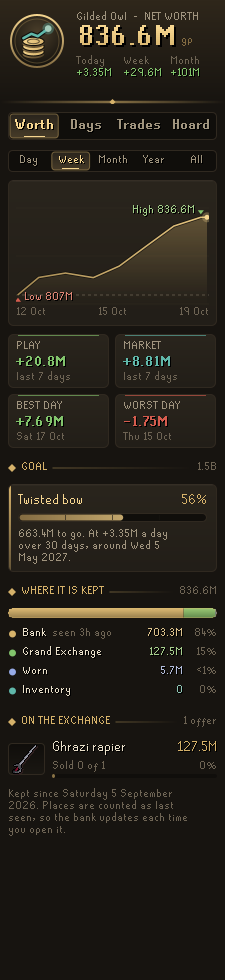
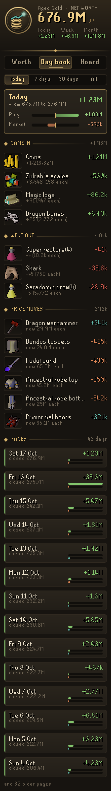
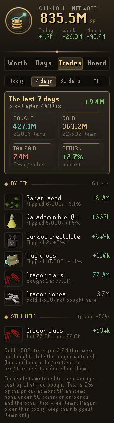
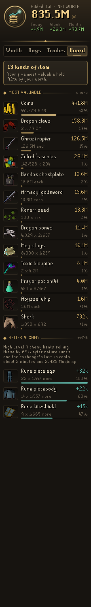
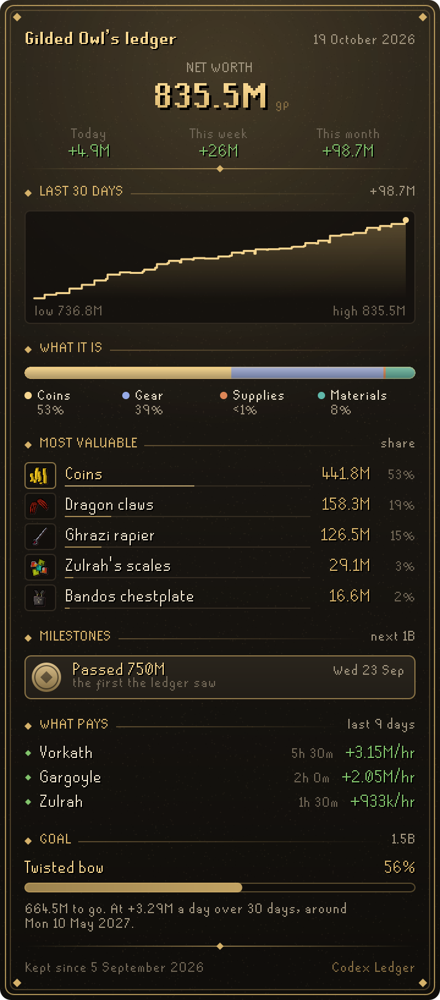
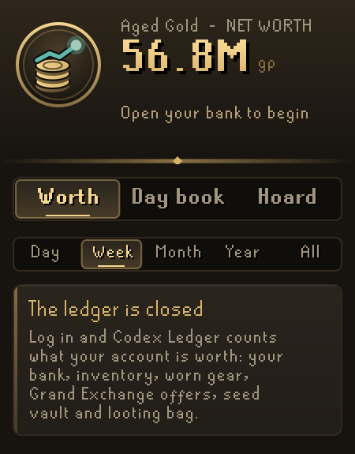
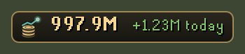

# Codex Ledger

**Your net worth over time, and where your gold came from and went.** Codex Ledger counts everything your account owns (bank, inventory, worn gear, Grand Exchange offers, rune pouch, seed vault and looting bag), draws your worth as a line over days, weeks and months, and keeps a day book that splits every change into what you gained or spent and what prices did.

It is part of the **Codex** suite and shares its look: warm ink, aged gold and the game's own fonts.

<p align="center">
  
  
  
  
</p>

## What you get

- **Worth.** Your net worth in large figures with today's, this week's and this month's change, and a chart for the last day, week, month, year or all time (hover it to read any moment). Below it: what your play made and what prices did, gold per hour logged in, your best and worst day, what your worth is made of (coins, gear, supplies, materials), where it is kept, and each Grand Exchange offer.
- **Goal.** Set a worth to aim for (a Twisted bow, say) and the Worth page shows how far along you are and the day you should get there at your last 30 days' pace. With no goal it aims at the next round figure.
- **Milestones.** Each round figure you pass (1M, 5M, 10M and on to every billion) is marked with the day and how long it took from the one before.
- **Day book** (the Days page). For today, 7 days, 30 days or all time: the change split into *play* and *market*, where the play came from (Exchange, Loot, Supplies, Coins in, Coins out, Deaths), the items that brought most in or took most out, and the biggest price moves. Then a month-by-month statement and a page for every day; click a page to open it.
- **Trades.** Every Grand Exchange trade with its profit after the 2% tax, your return on cost, and what you still hold from your buys with what it would fetch now. Items sold that the ledger never saw you buy are named, with no profit made up for them.
- **Hoard.** Everything you hold, most valuable first, with its share of your worth, and anything that High Level Alchemy turns into more coins than selling would (not shown for ironmen or below 55 Magic).
- **Ledger card.** A button on the Worth page draws your statement as a picture to save as a PNG or copy and paste anywhere.
- **Login summary** in the chat box, and an optional **plaque** in the game view with your worth and today's change.

<p align="center">
  
</p>
<p align="center">
  
  
</p>

## Settings that matter

| Setting | What it does |
| --- | --- |
| Summary at login | A chat line at login with your worth, today's change and how far it moved while you were away. On by default. |
| Worth plaque | A small plaque in the game view with your worth and today's change. Off by default. |
| Worth goal (millions) | A worth to aim for, in millions: 1500 is 1.5B. 0 aims at the next round figure. |
| Goal name | What the goal is for, shown with it on the Worth page and the card. |
| Name on cards | Writes your character's name on the ledger card. Turn it off to share the card without it. |

## With other Codex plugins

Codex Ledger works on its own. If you also use these, it reads (never writes) what they save:

- **[Codex Session Chronicle](https://github.com/Nubles/OSRS-Codex-Session-Chronicle)**: its journal of sessions, so the Worth page can show **What pays**, your activities over the last 30 days ranked by net worth gained an hour played.
- **[Codex Bank Steward](https://github.com/Nubles/OSRS-Codex-Bank-Steward)**: its saved copy of your bank, so before the ledger has seen your bank it can show an estimate, clearly marked as one. Nothing in it is booked.

Codex Annals, Gear Roadmap, Session Chronicle and Guardian read the worth this plugin saves.

## How it counts

The ledger begins the first time you open your bank. Each place is remembered as last seen: the bank whenever it is open, the inventory, gear and rune pouch all the time, the seed vault and looting bag when you open them, and the Grand Exchange from your offers. Changes are settled once a game tick, so moving items between places is never a gain or a loss. Items are valued at RuneLite's item price; items with no price count as nothing. About once a minute everything is revalued and the difference is booked as *market*.

Deaths are booked to the death, less what you get back from the gravestone or Death within the hour; safe deaths (raids, Inferno, Fight Caves, Colosseum and the safe minigames) take nothing. Places the game does not show (POH storage, STASH units, item sacks) are not counted, so putting items there shows as gold going out.

The ledger is saved per account in your RuneLite profile, every few minutes and when you log out, and kept under about 200 KB by thinning the oldest detail. A save damaged in part keeps everything that can still be read, and any save that could not be read whole is first copied aside (one copy, under `ledgerUnreadable`) so the next save never writes over the only copy.

## Rules posture

Codex Ledger only reads what the game already shows you and RuneLite's own item prices. It does not click, change menus, or send anything over the network. The ledger card is saved only where you choose.

## Development

```bash
./gradlew build   # compile and run tests
./gradlew run     # launch RuneLite with the plugin loaded
```

The ledger itself (`core/`) is plain Java with unit tests; the panel and overlay are in `ui/` and `overlay/`.
